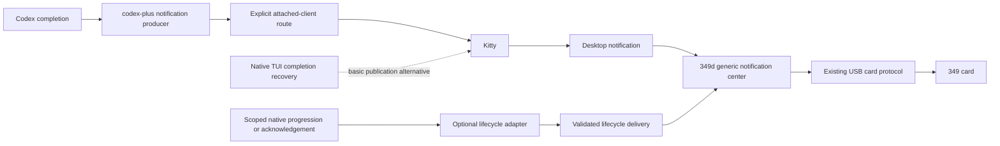
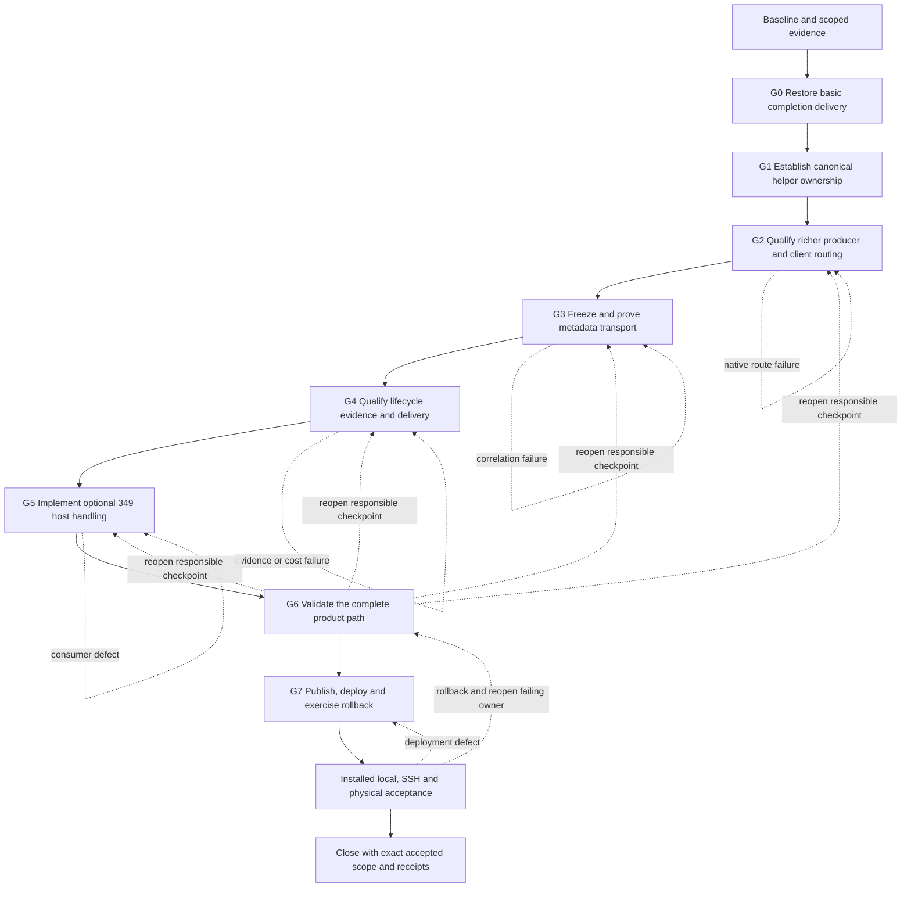

# Rich notifications and delivery recovery plan

Created: 2026-10-14. Updated: 2026-10-15. Status: a launch helper is now accepted
as the route to richer notifications with unfocused-only delivery and original
terminal focus. The hardened explicit launcher is installed on Starship/Snap;
ordinary launches keep native basic alerts. Local/SSH/tmux delivery and native
viewer lifetime checks pass. Daily shell activation and physical acceptance remain
open. The admission fix is source-qualified and has not replaced live 349d.
See the [October 15 checkpoint](rich-notifications-acceptance-2026-10-15.md) and
the [October 14 record](rich-notifications-acceptance-2026-10-14.md).
Physical/touch acceptance and draft review/merge remain explicit release gates.

[Project overview](../README.md) · [Architecture](architecture.md) · [Behavior](behavior.md)

## Product boundary

The 349 remains a generic desktop notification center. All applications use
the existing notification path and retention policy. Supported, versioned rich
metadata can enable additional presentation and card-lifecycle behavior within
that same center. A separate agent dashboard is outside this plan.

The loop must first restore ordinary Codex completion notifications, then add
optional richness and card lifecycle handling. At the initial incident checkpoint,
both Starship-local and Snap-to-Starship SSH notifications disappeared before
desktop/349 presentation, while Claude notifications still worked. The
[incident investigation](codex-notifications-incident.md) records the initial
detached-terminal reproduction and a subsequent config-first correction:
completion hooks work in the isolated shared-daemon study, while a remote TUI's
`-c notify=...` override does not reach the server. Callback publication and
attached-terminal delivery must be tested separately. Native TUI recovery is
selected on both hosts; installed-default and rollback checks pass. Physical
checks remain separate. Delivery recovery was the first execution gate.

The Codex notification helper is a generic utility for augmenting native Codex
notifications, useful independently of a physical display. Its canonical source,
behavioral tests and documentation now live in `codex-plus`. Chezmoi continues
to own pinned distribution, the installed `codex-notify` command and provider
configuration. The source ownership move began at candidate 6b1dbb6. Preview.1
runtime 7d05b07 was independently pinned and installed through chezmoi on both
hosts. Preview 3 (`2e6366c`) is now selected for the explicit launcher pilot, with
previews 1/2 retained and rollback/reselection qualified. Preview 3 preserves
native daemon feature policy in automatic dispatch; explicit delivery and
inspection retain preview 2 behavior. Installing the helper
does not select rich default delivery. The dated records identify each tuple.

## Ownership

| Component | Responsibility |
| --- | --- |
| codex-plus notification helper | Callback handling, notification content, Kitty/tmux delivery and generic rich metadata |
| Chezmoi | Pinned helper deployment, source provenance, installed-byte checks and Codex configuration |
| 349d | Desktop mirroring, optional rich-metadata interpretation, local card association and removal policy |
| Firmware | Existing bounded notification cache, touch presentation and host-directed card removal |
| Optional lifecycle adapter | Reliable scoped native progression or acknowledgement evidence; Observer is one possible adapter |

The helper must retain originating-terminal routing, unfocused-only delivery,
native Open/focus behavior, child/noninteractive suppression and quiet failure.
The 349 integration must keep unrelated notification content and actions useful.
On October 15 Bryan selected this policy explicitly: retain native basic alerts
and leave rich delivery experimental until native client support can preserve it.
The always-notify/new-terminal desktop candidate is not selected for defaults.
Later desktop tests confirmed native clicks focus Kitty both in a session and
in Command Center. Bryan then accepted a launch helper to preserve that behavior
while adding richness. The [codex-plus launcher plan](https://github.com/byebyebryan/codex-plus/blob/feat/notifications/docs/notification-launcher-plan.md)
owns the next pass. Existing dated acceptance records retain their earlier scope.

The launcher becomes the completion publisher for its wrapped client and obtains
content/identity from that native connection. A daemon hook is optional for this
route. Keep native completion and approval recovery for unwrapped clients;
separately qualify loaded-thread hook adoption and safe fallback. Desktop Open
focuses the originating terminal; selecting a thread inside Command Center stays
a native TUI interaction. Panel Open through DMS is a separate bridge gate.

## Proposed runtime flow

These publication paths are alternatives for a covered context. Select one
completion publisher so native TUI and helper delivery do not create duplicates.
Native TUI recovery is an interim basic-alert candidate; it does not establish
rich body/metadata parity. The producer and lifecycle paths must each prove their
own identity and delivery. The 349 consumes optional enrichment; source discovery
and native Codex protocol handling belong to the producer/adapter.

The initial preference was ordinary launching plus a configured `notify` helper.
After terminal association and desktop focus were clarified, the selected next
direction is the launch helper. The installed `codex-notify run` relay remains an
opt-in prototype until the owner plan's desktop/daily-use gates pass. The isolated
0.162.1 study proved that new threads read
changed user config without restarting the server, while loaded threads preserve
their hook config until the tested unload/resume boundary. Do not interrupt
ongoing work to force adoption.

The shared daemon's inherited environment is not an attached-client route.
Evaluate a supported client-side notification facility or explicit thread/client
route registration. Never guess an origin from a PID, most recent TTY, focused
window or daemon startup environment. Define behavior for multiple viewers,
thread switching, detached/closed clients and remote attachment before selecting
the richer route.

Also evaluate whether a configured desktop destination, with an explicit remote
transport, is sufficient for the helper. This can separate publication from an
originating TTY, but originating-terminal focus/Open and duplicate/fallback policy
remain gates. The current native OSC 9 alert carries no native thread/turn
identity; matching its text or timing to a hook event is not a safe enrichment
contract. Keep the basic recovery selected until a replacement route is proved.

## Rich metadata and card identity

Define a bounded, versioned envelope containing event kind, originating host,
native instance/namespace, thread ID and turn ID. Host display labels are separate
from source identity. Titles, project paths, process IDs and array positions are
not correlation keys. Optional display context can supply a useful host badge or
thread label without replacing the raw desktop-action identity.

Missing, malformed, unsupported or ambiguous metadata leaves an ordinary card
with normal retention. Confirmed metadata associates a local 349 card ID with
the exact native reference and notification episode. The first implementation
should keep this association on the host and reuse existing card-close messages;
firmware need not understand Codex protocols.
Metadata refresh, lifecycle delivery and recovery alone must not renew a card's
retention deadline, take manual focus or trigger a new backlight boost.

## Completion-card lifecycle

1. A completion notice for thread A / turn T1 arrives and creates an ordinary
   card with an optional rich association.
2. Reliable evidence establishes that a subsequent turn T2 has started for the
   same exact thread/source. Remove the associated T1 card locally.
3. T2 may already have finished when sampled; a current working phase is not
   required. Different opaque turn IDs alone do not establish chronological order.
4. If a delayed T1 notice arrives after progression is established, skip its
   display. Duplicate notices and later metadata must not revive a retired card.
5. Source failure, missing membership, ambiguous order or expired evidence leaves
   normal retention in force. Recovery must not manufacture acknowledgement.

Starting a subsequent turn supersedes an earlier completion notice; it does not
prove that the user read it. Explicit acknowledgement is a separate signal and
must have its own reliable correlation. Initial automatic removal affects only
the 349 card. Desktop close propagation is a separate product decision.

Start with completion cards. Approval/question notices need request/episode
correlation so resolving an old wait cannot remove a newer wait in the same turn.

## Lifecycle source and transport decisions still open

Rich identity identifies a card; it does not itself report acknowledgement or
progression. A lifecycle adapter must supply that evidence. A small Codex-specific
reader could inspect only exact threads with outstanding cards and stop when
their cards disappear. Cross-host use needs an explicit route to the owning daemon
or delivery from a source-host tracker. Existing Observer/Mesh can be an optional
adapter; it is not a mandatory dependency of the generic helper or notification
center. The implemented scoped native-history reader now passes controlled local
and SSH retirement through exact device-cache removal; see the dated checkpoints.

Kitty's OSC notification identifier is not forwarded as D-Bus correlation data
by the inspected installed code. Its notification-type metadata reaches the
D-Bus category. The implemented v1 category preserves exact identity through the
qualified local/SSH/tmux relay paths and direct desktop candidate. Focus filtering
and original-terminal Open remain independent producer gates; passing category
transport does not supply a client binding.

Lifecycle updates are control data, not new visible notification cards. Their
route must work after a desktop popup has timed out while its 349 history card
remains. Closing a live desktop notification alone does not prove removal of an
already archived device card. Define source binding, ordering, duplicate handling,
replay limits, source incarnation changes and recovery at this boundary.

An adapter may use supported native hooks, bounded exact-thread reads or an
already installed Observer feed. Each requires its own native proof; a documented
hook does not establish ordinary shared-daemon or SSH delivery. Compare standalone
dependency cost and measured CPU/memory at the intended cadence. The preferred
small implementation observes only identities associated with outstanding cards.
Source delivery sequence orders messages; it does not turn different opaque turn
IDs or receiving-host timestamps into proof of native turn chronology.

## Execution loop

This is one product loop with separately reviewable producer, distribution and
consumer checkpoints. A failed gate reopens its owning checkpoint; passing a
schema/unit test does not accept native routing, deployment or physical behavior.

| Gate | Primary owner | Reviewable result | Required exit evidence |
| --- | --- | --- | --- |
| Baseline | Each repository and installed host | Scoped source/runtime inventory, protected unrelated paths, current helper/configuration and rollback references | Recheck current checkout and installed state; no historical hash promoted to current deployment |
| G0: basic recovery | Codex configuration and chezmoi | Actual callback-context evidence and minimal native TUI recovery candidate | Fresh ordinary local/SSH completions reach desktop and 349 under expected focus policy; approvals remain useful; one completion alert per covered context |
| G1: ownership | codex-plus and chezmoi | Standalone helper, relocated behavioral tests, usage guide and pinned distribution/provenance design | Current attached-terminal behavior preserved; detached failure represented explicitly; stable installed command; producer inventory/source checks and distribution parity |
| G2: rich producer | codex-plus | Explicit client-routing design and independently testable notification producer | Shared-daemon, local, SSH and tmux native evidence; useful body, source identity, suppression, focus/Open and multiple-viewer behavior; no terminal guessed from daemon environment |
| G3: metadata | Producer and 349 notification source | Versioned bounded envelope, decoder and selected end-to-end transport | Exact host/instance/thread/turn identity survives desktop delivery; invalid/unsupported tags remain ordinary cards; existing action identity preserved |
| G4: lifecycle | codex-plus adapter; Observer optional | Selected narrow evidence source, control transport and recovery/order contract | Later-turn evidence, delayed notices, loss/reconnect and remote routing proved; CPU/memory measured; no mandatory full-fleet dependency |
| G5: consumer | esp32-349 notification-panel host | Optional association, stale-notice suppression and local card retirement; host context if justified | Existing wire sufficient where possible; coherent model/output locking, bounded association/retirement state, generic retention and Open unaffected |
| G6: product validation | Producer, distribution and consumer owners | Frozen candidate tuple and end-to-end comparison with the baseline | Deterministic, installed/native and device evidence clearly separated; complete acceptance matrix below passes or records an explicit unsupported boundary |
| G7: release and operation | Repository owners and chezmoi | Reviewed source checkpoints, published exact artifacts, scoped candidate selectors, backups and rollback procedure | Fetched bytes/pins verified; scoped dry-run/apply; installed readback and rollback/reselection; final fresh local/SSH notification path |
| Physical acceptance | User and 349 owner | Visible normal/rich notifications, superseded-card removal and touch/Open observation | Actual panel readability and behavior accepted separately from native renders and serial admission |

G0 can establish a basic recovery before G1-G5 richer work. Source changes,
artifact publication and installed selection remain separate: prepare a concrete
candidate before requesting any still-required deployment authorization. Preserve
the original daemon/thread lifetime and ordinary provider workflows. This plan
authorizes no native session restart, live service change or board flash.

G1 is a behavior-preserving ownership move, not a claim that the legacy terminal
route is repaired. G2 independently accepts that repair. Existing codex-plus
workers, watch/coordinator and report components retain their independent scope
and selectors. Avoid changing the whole deployed codex-plus bundle solely to
install a standalone notification utility when a separate pinned artifact is
sufficient.

If G2 cannot establish a safe explicit client route, keep accepted basic delivery
and record the rich producer as unresolved. If G3/G4 cannot establish correlation
or later-turn authority, retain generic cards and normal retention for those
contexts. Do not substitute title matching, disappearance, stale evidence or a
new-turn guess to pass a gate. A producer/native defect receives a separate
producer checkpoint rather than a simultaneous consumer workaround.

## Acceptance matrix

| Area | Cases and expected behavior |
| --- | --- |
| Delivery topology | Starship-local, Snap over SSH to Starship, direct Kitty and supported tmux paths; shared daemon, reconnect, multiple viewers, viewer closure and thread switching |
| Attention and content | Focused/unfocused policy, one completion publication, paragraphs and bounded UTF-8, child/noninteractive suppression, approvals, current native Open/focus behavior |
| Identity | Concurrent threads in one project, renamed/missing titles, duplicate host display labels, multiple native instances, missing/malformed/unsupported tags; raw desktop server/revision/action identities stay distinct |
| Supersession | T1 completion then T2 start, T2 finishing before observation, delayed T1, duplicate delivery, metadata replacement, user dismissal and replay; an old card cannot be resurrected or clear a newer card |
| Lifecycle uncertainty | Missing turn IDs/order, source loss, expired evidence, late responses, daemon/source incarnation change, gap/resync and restart; normal retention continues without invented acknowledgement |
| Desktop/device lifecycle | Popup expiry with retained 349 history, notification-server restart/ID reuse, daemon and USB reconnect, cache eviction/overflow and removal during gestures; stable bounds and coherent output |
| Regression and cost | Claude and other applications, generic retention, styled bodies, Open/dismiss, telemetry and backlight behavior; adapter CPU/memory and cancellation at actual publication/read cadence |
| Installation and product | Source checks, exact fetched artifacts, scoped managed deployment, installed readback, rollback/reselection, real desktop arrival, physical panel and touch acceptance |

Keep raw callbacks, prompts/responses, credentials, actual terminal captures and
build/capture output in private or ignored diagnostic storage. Commit only bounded
metadata, source identities needed for reproducibility and dated acceptance
summaries. Every deployment receipt identifies producer/adapter, host daemon,
configuration and relevant firmware versions separately.

## Current ledger

| Checkpoint | Status on 2026-10-15 |
| --- | --- |
| Agreed product boundaries and ownership | Captured; generic 349 center, codex-plus helper, chezmoi distribution, optional lifecycle adapter |
| Existing missing-notification investigation | Helper parity and fourteen isolated checks pass; detached `/dev/tty` failure reproduced on both hosts |
| G0 ordinary execution and recovery | Native basic completion alerts selected on both hosts; fresh installed-default local/SSH desktop checks pass; notification-only rollback/reselection passes |
| G1 ownership | codex-plus owns the helper; preview.5 independently checksum-pinned through chezmoi, with fourteen-file byte/executable readback on both hosts and prior helpers retained |
| G2-G5 implementation | Explicit rich native TUI route, v1 metadata, narrow read-only turn-history inspector and optional local retirement implemented; local/SSH full sequences and tmux passthrough pass |
| G2 config-first reopening | Normal launcher retained; configured hooks work in isolated shared 0.162.1 study. Remote TUI override inference corrected. Candidate episode deduplication is bounded; originating-client routing remains unavailable |
| G2 desktop-route candidate | Config hook and explicit local/SSH desktop transport implemented and qualified in controlled contexts. Always-notify/new-terminal defaults remain unselected |
| G2 selected launcher follow-up | Implemented terminal relay with positive root bindings, preserved native event filters and per-viewer actions. Preview 5 daily desktop Open passes on current owners in all four local/SSH and session/Command Center cases; original failed fixture attempts remain dated evidence |
| Launcher/consumer source hardening | The selected goal loop adds conservative launch dispatch, preserved native event filters, positive root bindings and distinct viewer action IDs. Private native Command Center/switch/legacy-resume cases pass. Bounded 349 admission suppresses stale first arrivals without blocking generic delivery; 433 host/tooling tests pass, three live desktop tests skip. Installed selection remains unchanged |
| Config-route lifecycle follow-up | October 15 local `100053` and SSH `100054` each reached the board, remained after panel presentation expiry, then disappeared from exact device-cache readback after newer interrupted turns; same board boot throughout. No physical acceptance claimed |
| Safe default transition | Fresh interactive user Zsh shells select the qualified helper on Starship/Snap; native configuration and existing sessions remain intact. Unsupported, agent and noninteractive calls stay native; both shell rollback/reselection checks pass |
| G6-G7 | Host/producer/distribution checks, source publication, installed device readback and helper/shell/config rollback/reselection pass. Live admission queue is active; daily local/SSH lifecycle, delayed-arrival suppression and generic regression pass. Source reviews remain drafts |
| Physical and wider acceptance | Pending physical/touch confirmation; existing DMS Open unavailable; additional native/UI contexts listed in the dated record |

The loop is complete only when agreed delivery, optional enrichment and local
card lifecycle behavior have installed and physical acceptance for the selected
contexts, with rollback and any unsupported contexts explicit. Passing source
checks or reaching a publication checkpoint alone does not close the loop.

The [completion notification investigation](codex-notifications-incident.md)
records the existing detached-helper failure and remaining recovery proof.

## Terminal-associated pilot checkpoint: 2026-10-15

The [producer launcher plan](https://github.com/byebyebryan/codex-plus/blob/feat/notifications/docs/notification-launcher-plan.md#installed-explicit-pilot-checkpoint-2026-10-15)
records the preview 2 delivery qualification and preview 3 policy follow-up,
native scope, rollback and acceptance
limits. The earlier October 15 config-route checkpoint retains its dated policy;
Bryan subsequently accepted the explicit launcher to supply terminal binding.

Actual installed local Kitty, Snap SSH and local tmux runs each suppressed a
foreground completion, then delivered one Codex notification in Command Center
with a host title, separate body and exact episode metadata. Device cards 100106,
100108 and 100110 respectively remained after 31 seconds and were absent after
the next exact turn started. Direct local/SSH viewer closure left the owned
native turn running; each completed after its loopback provider was released.
No real external model or credential was needed. All owned threads/windows were
cleaned up, native-created test-folder trust entries removed with exact config
hash restoration, and both native owner identities retained.

The candidate pre-admission fix at a46ccc8 holds configured rich arrivals in a
bounded queue while generic notifications bypass it. Its tests cover delayed
first arrivals, replacement races, slow evidence, removed routes and bounds.
An additional integration used the installed local/SSH inspectors and actual
native history from those owned cases: superseded delayed arrivals emitted zero
fake-wire packets. Full host/tooling checks passed 433 tests with three live
desktop skips; all six CI jobs passed, including both firmware builds.

This establishes candidate behavior; live 349d has not adopted that queue. No
firmware, DMS, native owner or protected service was restarted. Desktop click
confirmation, physical panel readability/removal, canonical distribution-source
convergence and daily-shell activation remain open. A local probe recorded the
target Kitty window gaining focus but did not capture the activating input; an
unobserved SSH click probe is not a failure result. The separate unavailable DMS
panel Open provider remains outside this loop's window-focus fix.

Chezmoi's prepared interactive entry point keeps typing `codex`, with native
utility/automation dispatch and explicit `/usr/bin/codex` available. Both host
activation switches remain false pending desktop acceptance. Installed helper
bytes and helper-only rollback/reselection pass on both hosts. Source branches
remain reviewable candidates; source publication is not fleet activation.

## Desktop and daily launcher follow-up

Preview 4 added a visible Open button through the originating Kitty terminal.
Actual local and Snap SSH session/Command Center checks correlated the returned
DMS notification ID, action 1 and focus of the exact Kitty window. Card body
clicks may expand text according to DMS preferences. Terminal Open does not switch
the native Command Center thread or repair the separate DMS panel Open provider.

Fresh interactive user shells on both hosts now select the helper. Exact shell
apply, rollback and reselection passed; agent and noninteractive shells remain
native. Both canonical chezmoi sources preserve unrelated Observer work, and no
broad apply ran. Existing sessions retain their original route.

Preview 5 at `8d1fea8e5f25bb71e0ef18ff424a73d7578ac8c0` is installed on both
hosts with fourteen-file readback and rollback/reselection to preview 4. Private
native checks qualify TUI/server pairs 0.162.1/0.162.1, 0.162.1/0.163.0 and
0.163.0/0.163.0. Other pairs and additional workspace-root launches stay native.
The managed servers independently transitioned to 0.163.0 during qualification;
no restart command was issued by this work and the cause was not established.

Actual fresh-shell `codex` delivery on both current owners reached the desktop
from Command Center with one rich notification, host title, separate body and
exact metadata. Owned threads were archived and owner identity remained stable
within these runs. The initial local click repeat captured no ActionInvoked signal,
and the initial Snap repeat was explicitly delivery-only. Corrected preview 5
daily-shell repeats now pass Open on both hosts in both session and Command Center
views: desktop IDs 611/613/614/615 each emitted exact action 1 and focused its
originating Kitty window. A continuous pointer connection and popup-scoped marker
lookup corrected the fixture; no producer or desktop preference change was needed.
Original failed attempts remain available and are not counted as acceptance.

The 349 pre-admission fix is now active after a scoped 349d-only restart. Daily
local/SSH cases retain cards beyond presentation expiry and remove the exact card
on a newer turn. Live delayed arrivals are held for native inspection and rejected
without a new device card observed; generic admission/close passes without native
inspection. Native owners and other services remain unchanged. Firmware and board
boot ID are unchanged. The [launcher checkpoint](notification-launcher-acceptance-2026-10-15.md)
records exact scope and rollback preparation. Physical readability, visible
retirement and touch acceptance remain open.
