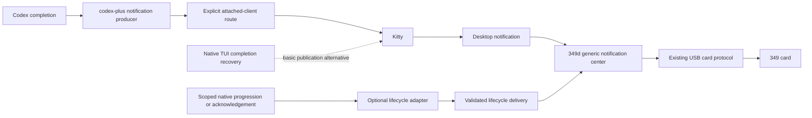
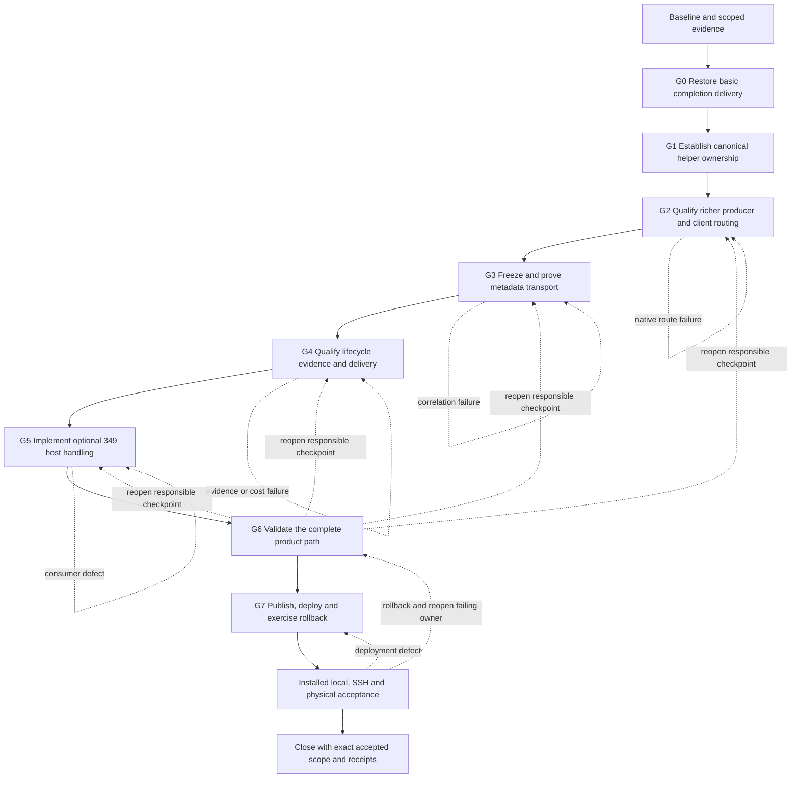

# Rich notifications and delivery recovery plan

Date: 2026-10-14. Status: execution loop active; basic notification recovery
selected, helper ownership checkpoint accepted locally, rich integration pending.

[Project overview](../README.md) · [Architecture](architecture.md) · [Behavior](behavior.md)

## Product boundary

The 349 remains a generic desktop notification center. All applications use
the existing notification path and retention policy. Supported, versioned rich
metadata can enable additional presentation and card-lifecycle behavior within
that same center. A separate agent dashboard is outside this plan.

The loop must first restore ordinary Codex completion notifications, then add
optional richness and card lifecycle handling. Both Starship-local and Snap-to-
Starship SSH notifications currently disappear before desktop/349 presentation,
while Claude notifications still work. The
[incident investigation](codex-notifications-incident.md) records the initial
detached-terminal reproduction and the later native correction: embedded CLI
callbacks have a terminal, while tested shared/remote TUI completions emitted
native alerts without invoking the configured callback. Native TUI recovery is
selected on both hosts; final ordinary-default, rollback and physical checks
remain part of G0/G7. Delivery recovery is the first execution gate.

The Codex notification helper is a generic utility for augmenting native Codex
notifications, useful independently of a physical display. Its canonical source,
behavioral tests and documentation should move to `codex-plus`. Chezmoi continues
to own pinned distribution, the installed `codex-notify` command and provider
configuration. The source ownership move is prepared in codex-plus candidate
6b1dbb6 with fourteen behavioral checks passing. Managed distribution is pending;
metadata and lifecycle behavior have independent following checkpoints.

## Ownership

| Component | Responsibility |
| --- | --- |
| codex-plus notification helper | Callback handling, notification content, Kitty/tmux delivery and generic rich metadata |
| Chezmoi | Pinned helper deployment, source provenance, installed-byte checks and Codex configuration |
| 349d | Desktop mirroring, optional rich-metadata interpretation, local card association and removal policy |
| Firmware | Existing bounded notification cache, touch presentation and host-directed card removal |
| Optional lifecycle adapter | Reliable scoped native progression or acknowledgement evidence; Observer is one possible adapter |

The helper must retain originating-terminal routing, unfocused-only delivery,
native Open/focus behavior, child/noninteractive suppression and quiet failure.
The 349 integration must keep unrelated notification content and actions useful.

## Proposed runtime flow

These publication paths are alternatives for a covered context. Select one
completion publisher so native TUI and helper delivery do not create duplicates.
Native TUI recovery is an interim basic-alert candidate; it does not establish
rich body/metadata parity. The producer and lifecycle paths must each prove their
own identity and delivery. The 349 consumes optional enrichment; source discovery
and native Codex protocol handling belong to the producer/adapter.

The shared daemon's inherited environment is not an attached-client route.
Evaluate a supported client-side notification facility or explicit thread/client
route registration. Never guess an origin from a PID, most recent TTY, focused
window or daemon startup environment. Define behavior for multiple viewers,
thread switching, detached/closed clients and remote attachment before selecting
the richer route.

## Rich metadata and card identity

Define a bounded, versioned envelope containing event kind, originating host,
native instance/namespace, thread ID and turn ID. Host display labels are separate
from source identity. Titles, project paths, process IDs and array positions are
not correlation keys. Optional display context can supply a useful host badge or
thread label without replacing the raw desktop-action identity.

Missing, malformed, unsupported or ambiguous metadata leaves an ordinary card
with normal retention. Confirmed metadata associates a local 349 card ID with
the exact native reference and notification episode. The first implementation
should keep this association on the host and reuse existing card-close messages;
firmware need not understand Codex protocols.
Metadata refresh, lifecycle delivery and recovery alone must not renew a card's
retention deadline, take manual focus or trigger a new backlight boost.

## Completion-card lifecycle

1. A completion notice for thread A / turn T1 arrives and creates an ordinary
   card with an optional rich association.
2. Reliable evidence establishes that a subsequent turn T2 has started for the
   same exact thread/source. Remove the associated T1 card locally.
3. T2 may already have finished when sampled; a current working phase is not
   required. Different opaque turn IDs alone do not establish chronological order.
4. If a delayed T1 notice arrives after progression is established, skip its
   display. Duplicate notices and later metadata must not revive a retired card.
5. Source failure, missing membership, ambiguous order or expired evidence leaves
   normal retention in force. Recovery must not manufacture acknowledgement.

Starting a subsequent turn supersedes an earlier completion notice; it does not
prove that the user read it. Explicit acknowledgement is a separate signal and
must have its own reliable correlation. Initial automatic removal affects only
the 349 card. Desktop close propagation is a separate product decision.

Start with completion cards. Approval/question notices need request/episode
correlation so resolving an old wait cannot remove a newer wait in the same turn.

## Lifecycle source and transport decisions still open

Rich identity identifies a card; it does not itself report acknowledgement or
progression. A lifecycle adapter must supply that evidence. A small Codex-specific
reader could inspect only exact threads with outstanding cards and stop when
their cards disappear. Cross-host use needs an explicit route to the owning daemon
or delivery from a source-host tracker. Existing Observer/Mesh can be an optional
adapter; it is not a mandatory dependency of the generic helper or notification
center. No lightweight adapter has been qualified for this path yet.

Kitty's OSC notification identifier is not forwarded as D-Bus correlation data
by the inspected installed code. Its notification-type metadata reaches the
D-Bus category, providing a candidate for carrying a versioned tag. This is a
transport hypothesis, not an accepted contract. Prove bounded decoding and
identity preservation through local, SSH and tmux delivery, including focus
filtering and Open. Choose a separate explicit metadata route if necessary.

Lifecycle updates are control data, not new visible notification cards. Their
route must work after a desktop popup has timed out while its 349 history card
remains. Closing a live desktop notification alone does not prove removal of an
already archived device card. Define source binding, ordering, duplicate handling,
replay limits, source incarnation changes and recovery at this boundary.

An adapter may use supported native hooks, bounded exact-thread reads or an
already installed Observer feed. Each requires its own native proof; a documented
hook does not establish ordinary shared-daemon or SSH delivery. Compare standalone
dependency cost and measured CPU/memory at the intended cadence. The preferred
small implementation observes only identities associated with outstanding cards.
Source delivery sequence orders messages; it does not turn different opaque turn
IDs or receiving-host timestamps into proof of native turn chronology.

## Execution loop

This is one product loop with separately reviewable producer, distribution and
consumer checkpoints. A failed gate reopens its owning checkpoint; passing a
schema/unit test does not accept native routing, deployment or physical behavior.

| Gate | Primary owner | Reviewable result | Required exit evidence |
| --- | --- | --- | --- |
| Baseline | Each repository and installed host | Scoped source/runtime inventory, protected unrelated paths, current helper/configuration and rollback references | Recheck current checkout and installed state; no historical hash promoted to current deployment |
| G0: basic recovery | Codex configuration and chezmoi | Actual callback-context evidence and minimal native TUI recovery candidate | Fresh ordinary local/SSH completions reach desktop and 349 under expected focus policy; approvals remain useful; one completion alert per covered context |
| G1: ownership | codex-plus and chezmoi | Standalone helper, relocated behavioral tests, usage guide and pinned distribution/provenance design | Current attached-terminal behavior preserved; detached failure represented explicitly; stable installed command; producer inventory/source checks and distribution parity |
| G2: rich producer | codex-plus | Explicit client-routing design and independently testable notification producer | Shared-daemon, local, SSH and tmux native evidence; useful body, source identity, suppression, focus/Open and multiple-viewer behavior; no terminal guessed from daemon environment |
| G3: metadata | Producer and 349 notification source | Versioned bounded envelope, decoder and selected end-to-end transport | Exact host/instance/thread/turn identity survives desktop delivery; invalid/unsupported tags remain ordinary cards; existing action identity preserved |
| G4: lifecycle | codex-plus adapter; Observer optional | Selected narrow evidence source, control transport and recovery/order contract | Later-turn evidence, delayed notices, loss/reconnect and remote routing proved; CPU/memory measured; no mandatory full-fleet dependency |
| G5: consumer | esp32-349 notification-panel host | Optional association, stale-notice suppression and local card retirement; host context if justified | Existing wire sufficient where possible; coherent model/output locking, bounded association/retirement state, generic retention and Open unaffected |
| G6: product validation | Producer, distribution and consumer owners | Frozen candidate tuple and end-to-end comparison with the baseline | Deterministic, installed/native and device evidence clearly separated; complete acceptance matrix below passes or records an explicit unsupported boundary |
| G7: release and operation | Repository owners and chezmoi | Reviewed source checkpoints, published exact artifacts, scoped candidate selectors, backups and rollback procedure | Fetched bytes/pins verified; scoped dry-run/apply; installed readback and rollback/reselection; final fresh local/SSH notification path |
| Physical acceptance | User and 349 owner | Visible normal/rich notifications, superseded-card removal and touch/Open observation | Actual panel readability and behavior accepted separately from native renders and serial admission |

G0 can establish a basic recovery before G1-G5 richer work. Source changes,
artifact publication and installed selection remain separate: prepare a concrete
candidate before requesting any still-required deployment authorization. Preserve
the original daemon/thread lifetime and ordinary provider workflows. This plan
authorizes no native session restart, live service change or board flash.

G1 is a behavior-preserving ownership move, not a claim that the legacy terminal
route is repaired. G2 independently accepts that repair. Existing codex-plus
workers, watch/coordinator and report components retain their independent scope
and selectors. Avoid changing the whole deployed codex-plus bundle solely to
install a standalone notification utility when a separate pinned artifact is
sufficient.

If G2 cannot establish a safe explicit client route, keep accepted basic delivery
and record the rich producer as unresolved. If G3/G4 cannot establish correlation
or later-turn authority, retain generic cards and normal retention for those
contexts. Do not substitute title matching, disappearance, stale evidence or a
new-turn guess to pass a gate. A producer/native defect receives a separate
producer checkpoint rather than a simultaneous consumer workaround.

## Acceptance matrix

| Area | Cases and expected behavior |
| --- | --- |
| Delivery topology | Starship-local, Snap over SSH to Starship, direct Kitty and supported tmux paths; shared daemon, reconnect, multiple viewers, viewer closure and thread switching |
| Attention and content | Focused/unfocused policy, one completion publication, paragraphs and bounded UTF-8, child/noninteractive suppression, approvals, current native Open/focus behavior |
| Identity | Concurrent threads in one project, renamed/missing titles, duplicate host display labels, multiple native instances, missing/malformed/unsupported tags; raw desktop server/revision/action identities stay distinct |
| Supersession | T1 completion then T2 start, T2 finishing before observation, delayed T1, duplicate delivery, metadata replacement, user dismissal and replay; an old card cannot be resurrected or clear a newer card |
| Lifecycle uncertainty | Missing turn IDs/order, source loss, expired evidence, late responses, daemon/source incarnation change, gap/resync and restart; normal retention continues without invented acknowledgement |
| Desktop/device lifecycle | Popup expiry with retained 349 history, notification-server restart/ID reuse, daemon and USB reconnect, cache eviction/overflow and removal during gestures; stable bounds and coherent output |
| Regression and cost | Claude and other applications, generic retention, styled bodies, Open/dismiss, telemetry and backlight behavior; adapter CPU/memory and cancellation at actual publication/read cadence |
| Installation and product | Source checks, exact fetched artifacts, scoped managed deployment, installed readback, rollback/reselection, real desktop arrival, physical panel and touch acceptance |

Keep raw callbacks, prompts/responses, credentials, actual terminal captures and
build/capture output in private or ignored diagnostic storage. Commit only bounded
metadata, source identities needed for reproducibility and dated acceptance
summaries. Every deployment receipt identifies producer/adapter, host daemon,
configuration and relevant firmware versions separately.

## Current ledger

| Checkpoint | Status on 2026-10-14 |
| --- | --- |
| Agreed product boundaries and ownership | Captured; generic 349 center, codex-plus helper, chezmoi distribution, optional lifecycle adapter |
| Existing missing-notification investigation | Helper parity and fourteen isolated checks pass; detached `/dev/tty` failure reproduced on both hosts |
| G0 ordinary execution and recovery | Embedded/shared paths distinguished; native OSC 9 proved on both hosts; desktop/USB delivery proved; guarded two-key native recovery selected on both hosts; physical acceptance and rollback exercise pending |
| G1 ownership | codex-plus candidate 6b1dbb6 owns the helper and fourteen passing behavioral checks; managed artifact switch pending |
| G2-G5 implementation | Rich client route/schema/adapter not accepted; no card-lifecycle implementation |
| G6-G7 and physical acceptance | Pending; no rich-feature installation, service change or firmware deployment |

The loop is complete only when agreed delivery, optional enrichment and local
card lifecycle behavior have installed and physical acceptance for the selected
contexts, with rollback and any unsupported contexts explicit. Passing source
checks or reaching a publication checkpoint alone does not close the loop.

The [completion notification investigation](codex-notifications-incident.md)
records the existing detached-helper failure and remaining recovery proof.
